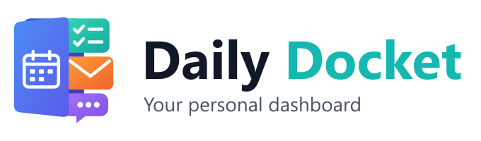

<p align="center">
  <picture>
    <source media="(prefers-color-scheme: dark)" srcset="assets/brand/logo-dark.svg">
    
  </picture>
</p>

# DailyDocket

A Windows desktop app that puts one person's day on one screen: the week's schedule, a to-do list,
the email that needs a reply, and the Slack conversations that need a reply. It keeps a local copy
of all of it, so it works offline, and it never sends anything until its owner presses Send.

DailyDocket is a personal tool, built for one person's accounts and habits, and is public so its
releases can update every machine without a token. It is shared as an example of the approach
rather than as a product; nothing personal is in this repository.

## How it works

- **Claude Code is the only connection to Gmail, Google Calendar and Slack.** Each sync starts
  Claude Code headless (`claude -p`) with the owner's own Claude login and the claude.ai connectors
  already set up for it. There is no Google Cloud project or Slack app to register.
- **The model decides what to fetch; it never retypes what it fetched.** A hook saves each
  connector result verbatim, and C# parsers turn those captures into rows in a local SQLite
  database (encrypted with SQLCipher). Claude then sees a short receipt instead of the mail.
- **Claude judges which conversations need a reply**, one conversation per run, from the local
  copy, with no connector tools at all.
- **Everything written goes to an outbox first.** A reply is sent by its own run, which cannot
  read mail, and a `PreToolUse` guard lets through only the exact call the owner approved, once.
  Anything new in the conversation since the reply was started holds it for a look.
- **To-dos, Handled marks, shared verdicts and meeting briefs live in a separate private git
  repository**, one file per item, so several computers stay in step and each works offline.
- **One computer runs the nightly jobs**: a deep sweep of older mail and a short brief for each
  upcoming meeting. A lease file in the data repository lets another computer take over when that
  one misses a night.

`docs/design.md` is the full design, including what was checked live and why each choice was
made.

## What it needs

- Windows 11, x64 or ARM64 (both are built natively).
- [Claude Code](https://code.claude.com), signed in with a Claude account that has the Gmail,
  Google Calendar and Slack connectors (and Google Drive, for meeting prep) connected on claude.ai.
- Git, for the data repository.
- A private GitHub repository for the data, and a `config/docket.yaml` in it describing the owner
  (addresses, Slack id, calendars, which machine runs the nightly jobs).
  `docs/docket.example.yaml` shows the format.

## Installing

Download `MacCoss.DailyDocket-win-x64-Setup.exe` or `MacCoss.DailyDocket-win-arm64-Setup.exe`
from the latest [release](https://github.com/maccoss/DailyDocket/releases) and run it. The app
checks for updates at startup and every four hours, downloads them in the background, and offers a
**Restart** button; it never restarts by itself.

Then, once per computer:

```powershell
irm https://claude.ai/install.ps1 | iex
```

```powershell
claude auth login --claudeai
```

```powershell
winget install --id Git.Git --exact --source winget
```

The window's banner says which of these is still missing. Claude Code keeps its own sign-in,
separate from the Claude desktop app's.

## Building from source

Needs the .NET 10 SDK (`global.json` pins it).

```powershell
dotnet build DailyDocket.slnx -c Debug
```

```powershell
dotnet test --project src/DailyDocket.Tests/DailyDocket.Tests.csproj
```

Set `DAILYDOCKET_DATA` to a folder to keep a development copy's settings, database and logs apart
from an installed one's. Publishing the hook with Native AOT needs Visual Studio's C++ build tools.
`CLAUDE.md` describes the layout, the opt-in live tests, and how releases are made.

| Project | What it holds |
| --- | --- |
| `src/DailyDocket.Core` | All logic: parsers, rules, job plans, the outbox, the nightly lease, meeting prep |
| `src/DailyDocket.Data` | The SQLite cache and outbox |
| `src/DailyDocket.Hook` | The hook Claude Code runs: capture after a tool call, the send guard before one |
| `src/DailyDocket.App` | The WPF window, tray icon and notifications |
| `src/DailyDocket.Tests` | xUnit tests, on synthetic data in the connectors' real shapes |

## Status

Working day to day: the four tabs, offline reading, to-dos and Handled marks in git, replies to
email and Slack through the outbox, RSVPs, Draft with Claude, the nightly deep sweep and meeting
prep, tray and notifications. Still to come: creating and moving events, and offline drafting with
a local model (Foundry Local).

Release notes for each version are in `release-notes/`.

## License

Apache 2.0; see `LICENSE`.
